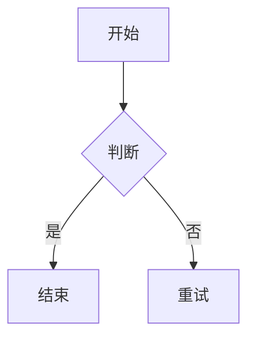

# 中间位置 Mermaid 激活遮挡修复

日期：2026-11-22
基线：`45207cd docs: 回填 Rune props 清单状态`

## 1. 问题

Muya 的容器块（Mermaid / flowchart / sequence / vega-lite）在激活时，`div.ag-container-preview` 是 `position:absolute; top:calc(100% + 20px); z-index:10000`。它不参与文档流：

- 文末：预览会压住底部浮动操作栏，之前的补丁只给 `:last-child` 改成 `static`；
- 中间：预览直接盖在后续正文上，段落文字被遮住，且文档滚动高度不变。

## 2. 复现数据

1123×748，正文：

````md
# Mermaid 中间遮挡验收



这段正文在 Mermaid 后面，激活时不应被预览盖住。
````

激活后实测：

| 元素 | 修复前 |
|---|---|
| figure | top 149 / bottom 279 / height 130 |
| preview | top 299 / bottom 429 / height 130，`position: absolute` |
| 后续第一段 | top 301.39 / bottom 326.98 |

预览与后续正文重叠约 128px，文字完全落在浮层下面。

## 3. 修复

`frontend/src/styles/index.css`：把只作用于 `:last-child` 的规则扩展到所有激活态容器块：

```css
#ag-editor-id > figure.ag-active.ag-container-block > div.ag-container-preview {
  position: static;
  top: auto;
  left: auto;
  transform: none;
  margin: 20px auto 0;
}
```

预览回到文档流，由它自己撑高 figure；不再用 `z-index:10000` 盖正文，也不依赖“是不是最后一个”。

## 4. 修复后验收

| 元素 | 修复后 |
|---|---|
| figure | top 149 / bottom 635.375 / height 486.375 |
| preview | top 299 / bottom 635.375 / height 336.375，`position: static` |
| 后续第一段 | top 657.77 / bottom 683.36 |

预览底边 635.375，正文顶边 657.77，间距约 22.4px，无重叠。

文末回归：Mermaid 放文末并滚到底，preview 底边 611.375，操作栏顶边 682，重叠 0。

对照图：`docs/mermaid-mid-20261122.png`（before 浮层盖正文 / after 文档流撑开）。

## 5. 影响与已知限制

- 激活态预览现在会占真实高度，中间 Mermaid 激活时下方内容会被向下推开，这是预期行为，不再覆盖。
- 预览与源码 `pre` 同时可见，整体块高度变大；v2 的浮层行为本来就是“编辑时临时浮出”，这里选择用文档流换取“不遮挡”。如果后续要求编辑时只看源码，需要单独做“激活隐藏预览”的交互，而不是回退 absolute。
- 本规则覆盖 Mermaid、flowchart、sequence、vega-lite、multiplemath 等所有 `ag-container-block` 激活态，不只 Mermaid。
