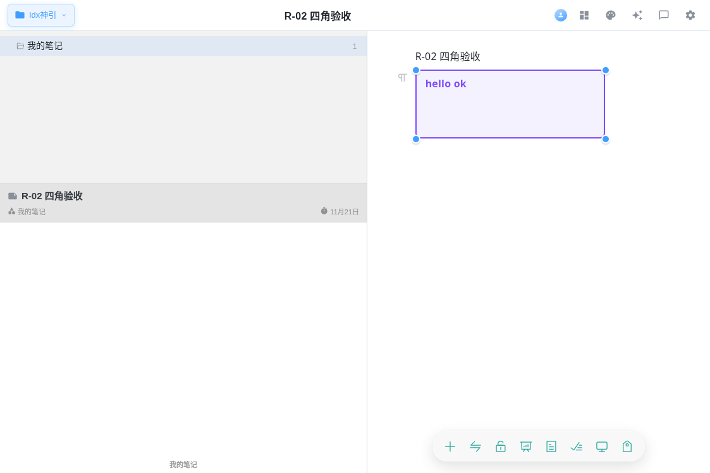

# R-02：Rune 四角缩放实测

日期：2026-11-22
基线：`98c3918 refactor(editor): 合并 StateRender 重复 Rune 渲染入口`
目标：`desktop-vue3/frontend/src/editor/runeTransformer.ts`、`EditorPane.vue`

## 验收设置

- 页面 1123×748，1 条笔记、1 个块级 Rune 模板，初始 `data-rune-width="300"`、`data-rune-height="80"`。
- 初始宿主矩形：`left=656.656`、`top=110.203`、`right=956.656`、`bottom=190.203`。
- 四个控制点中心分别贴宿主四角：`(657.656,111.203)`、`(957.656,111.203)`、`(657.656,191.203)`、`(957.656,191.203)`。
- 每角用真实鼠标事件拖拽：右下 `+50/+30`，左下 `-50/+30`，右上 `+50/-30`，左上 `-50/-30`。

## 四角结果

| 控制点 | 拖动后宿主矩形 | 宽高 | 实际变化 | 结论 |
| --- | --- | --- | --- | --- |
| 右下 | left 656.656 / top 110.203 / right 1005.656 / bottom 220.203 | 349×110 | 左边、上边不动；右边 +49、下边 +30 | 右边、下边跟手 |
| 左下 | left 656.656 / top 110.203 / right 956.656 / bottom 221.203 | 300×111 | 左边、上边不动；右边不动、下边 +31；横向被 `maxWidth=300` 夹住 | 左边不跟手 |
| 右上 | left 656.656 / top 110.203 / right 1006.656 / bottom 219.203 | 350×109 | 左边、上边不动；右边 +50、下边 +29 | 上边不跟手 |
| 左上 | left 656.656 / top 110.203 / right 956.656 / bottom 219.203 | 300×109 | 左边、上边不动；右边不动、下边 +29；横向被夹住 | 左边、上边都不跟手 |

结论：当前 v3 的行为是“宿主左上角固定，四个控制点都只改宽高”。右、下控制点看起来正常；左、上控制点在拖动时不会移动对应边，甚至左上手柄会原地不动。

这不是 v3 独有回归。`desktop-vue2/src/components/muya/runeTransformer.js` 用的是同一套公式：

```js
const rawWidth = movingAnchor.indexOf('left') > -1
  ? right - event.clientX
  : event.clientX - left
const rawHeight = movingAnchor.indexOf('top') > -1
  ? bottom - event.clientY
  : event.clientY - top
```

两处都只把 `width/height` 写回宿主，不写任何 x/y 偏移，所以左、上拖动不可能让左边/上边跟随鼠标。相应边界夹取也一样：左下/左上拖到父容器左边时，`maxWidth = right - boundary.left` 最大只能等于当前宽度，无法向左扩宽。

按“与 vue2 一致”的复刻口径，R-02 的四角对照完成，结论是 **v2 同源限制，不是 v3 移植缺口**。没有为了“看起来正确”发明 `data-rune-offset-x/y` 之类 v2 不认识的字段，避免同一篇 Markdown 在 v2/v3 里排版分叉。



## 本次实际修复：写回后卡片消失

拖拽松手时 `commitRuneResize` 原来走 `setMarkdownWithCursor(next, cursor)`。点击 Rune 后选区落在 Rune 宿主内，把这个光标位置带进重载后，raw HTML 块会退化成裸文本：

```text
R-02 四角验收<div data-rune-name="合并验收" ... data-rune-width="349" data-rune-height="110"></div>空
```

结果是尺寸写回了，但卡片消失，只剩源码文本。

修复：`commitRuneResize` 改为普通 `setMarkdown(next)`。尺寸提交不需要恢复 Rune 内选区，普通重载能稳定重建占位宿主。

修复后复验：

| 动作 | 结果 |
| --- | --- |
| 右下拖 `+50/+30` | 卡片保留，`hello ok` 可见，宿主 349×110，Markdown 写回 `349/110` |
| 左上拖 `-50/-30` | 卡片保留，`hello ok` 可见，宿主 300×109，Markdown 写回 `300/109` |
| 四控制点 | 仍为 4 个，中心贴宿主四角 |

## 检查

- `pnpm typecheck` 通过
- `pnpm test:runtime` 全部通过
- `pnpm build-frontend` 通过

## 未完成边界

如果产品要求“真正的四角锚定缩放”，需要给 Markdown 增加持久化偏移（例如 `data-rune-offset-x/y`），渲染时转成 `margin-left/top` 或 `transform`。这会超出 v2 的属性 ABI，也会让 v2 打开同一篇笔记时位置不同，必须先做产品决策。本次不擅自加字段。

R-02 状态按“复核完成 + 修掉 v3 独有的写回丢卡”记录，不把左、上锚点缺失伪装成已修复。

## 后续（2026-11-22）：产品拍板新增偏移字段

用户随后明确要求“新增持久化字段”。已新增 `data-rune-offset-x` / `data-rune-offset-y`，四角真锚定落地，左/上拖动对应边跟手，写回后重渲染保持。v2 会忽略这两个字段，ABI 差异已作为拍板结果接受。详见 `rune-offsets-20261122.md`。

上述“未完成边界”中关于“必须先做产品决策、本次不擅自加字段”的限制已解除；本文件保留当时的基线记录，不回写成已实现。
