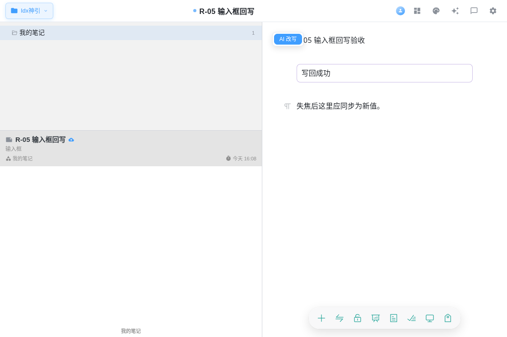

# R-05b：符文输入事件写回

日期：2026-11-22
基线：`f9009cb fix(echo): 四张内置回响恢复动画宿主与文档根`
目标：`libs-muya-rune-vue3/src/runeRenderer.ts`

## 缺口

内置「输入框」模板失焦时只做一件事：

```js
this.$emit('input', next)
```

v3 挂载层给符文组件注入的是 `onValueChange`，没有声明 `onInput`。Vue 3 会把组件 `emit('input')` 解析成 `onInput` 监听器，所以这次 emit 没有接收方：

- 卡片里输入框的值变了；
- Markdown 的 `data-rune-value` 不变；
- 重新打开笔记又回到旧值。

## 修复

在 `RuneRenderer` 的挂载 props 中补 `onInput`，并桥到既有的 `onValueChange`：

```ts
state.onInput = (next) => {
  if (typeof state.onValueChange === 'function') {
    state.onValueChange({
      runeId: state.runeId || '',
      nodeId: state.nodeId || '',
      value: next,
    });
  }
};
```

选择在渲染器层桥接，而不是改每张内置模板：

- 内置模板和用户自建 SFC 的 `$emit('input')` ABI 不变；
- 原来直接调用 `onValueChange` 的模板不受影响；
- 回写仍走 `updateRunePlaceholderValue`，不新增第二套写 Markdown 逻辑。

## 验证

### 单元回归

新增一条真实 Vue 渲染用例：模板 `<input @input="onType">`，方法内 `$emit('input', event.target.value)`，挂载后派发 input 事件。

断言结果：

```text
OK   符文 renderer 可编译输入模板
OK   符文 input 事件桥接到 onValueChange
```

### 1123×748 真实页面

- 注入 14 张内置符文卡，打开笔记 `R-05 输入框回写`。
- 正文占位：`<div data-rune-name="输入框" ... data-rune-node-id="input-n1" data-rune-value="初始"></div>`。
- 输入框尺寸 `390.6875×41.59375`，初值 `初始`。
- 输入框改值为 `写回成功`，触发模板的 `blur` handler。
- 写回结果：

```text
data-rune-value="写回成功"
<div ...>写回成功</div>
```

- 卡片仍在 DOM 中，输入框显示 `写回成功`，未退化成裸 HTML。



## 未覆盖

- 只桥接 `input` 事件；`update:modelValue` 的 v-model 风格模板尚未接。
- 回写依赖 `updateRunePlaceholderValue` 的 `setMarkdown`，因此大文档下仍是整篇重渲染，不是局部 patch。
- 真实页面验收用输入框 focus + 改值 + dispatch `blur` 触发模板 handler；没有把“鼠标点中输入框”作为独立断言。

## 检查

- `pnpm typecheck`
- `pnpm test:runtime`
- `pnpm build-frontend`
