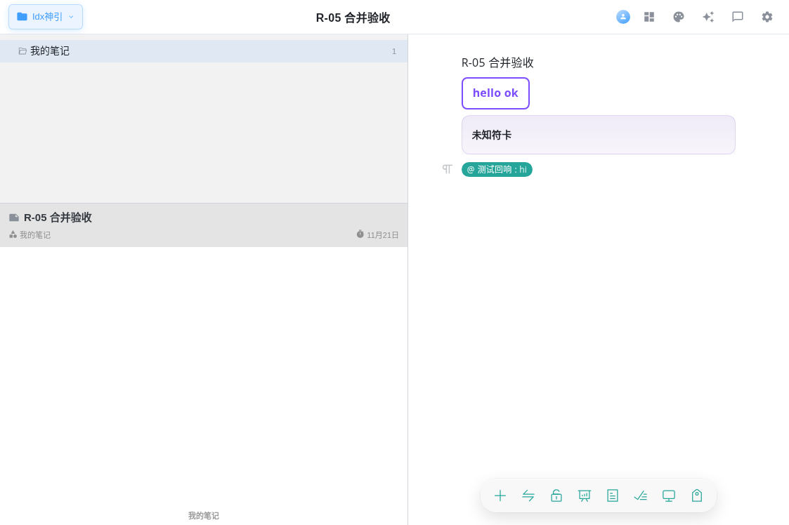

# R-05：StateRender 重复渲染入口合并

日期：2026-11-22
基线：`2f33733 fix(editor): 外链图片不再被 HEAD 跨域预检误判`
目标：`libs-muya-vue3/src/core/parser/render/index.js`

## 问题

`StateRender` 类里有两个同名方法被先后定义，后一个覆盖前一个：

| 方法 | 旧定义 | 生效定义 |
| --- | --- | --- |
| `mountRuneVueHosts` | 661 行，回写源取 `memoMuya`，无 try/catch、无失败兜底 | 844 行，回写源也取 `memoMuya`，有日志、构造 try/catch 和占位卡兜底 |
| `renderRunes` | 815 行，只调 `postRenderEchoPlaceholders()` + `postRenderRunePlaceholders()` | 1121 行，走占位节点渲染、清理 detached 占位符、按开关走 Vue 渲染、最后执行 `runtime.afterRender()` |

旧定义不会执行，但会持续误导：改错一处看似生效、实际被后一处覆盖；两套逻辑也会让后续维护把“回响/符文入口”接错。

## 合并口径

1. 保留生效定义的行为骨架：构造失败时回填 `createRunePlaceholderMarkup(rune, dataset)`，并写 `host.dataset.runeRenderKey`。
2. 删除旧 `mountRuneVueHosts` 与旧 `renderRunes`，类中两个入口各只剩一处定义。
3. 回写源改为 `this.muya?.options?.memocastMuya || this.muya?.options?.memoMuya || null`。
   - v3 插件 `libs-muya-rune-vue3/src/index.ts` 写的是 `memocastMuya`，此前生效版只读 `memoMuya`，实际取到 null。
   - `memoMuya` 是 v2 `Muya.vue` 的旧名，保留为旧宿主兼容回退。
4. 删除 `mountRuneVueHosts` 内的调试 `console.log`，只保留构造失败 `console.warn`。
5. `renderRunes` 保留生效版的顺序：`renderRunePlaceholderNodes()` → `renderEchoPlaceholders()` → 清理 detached 占位符 → 按 `enableRuneVueRenderer` 调 `renderRunesWithVue()` → `runtime.afterRender(root, { cleanupFirst: true })`。

合并后位置：`mountRuneVueHosts` 728 行，`renderRunesWithVue` 961 行，`renderRunes` 968 行。`mountRuneVueInstances` 671 行仍保留一个 wrapper 调用，避免附近既有调用点断链。

## 真实页面验收

浏览器 1123×748，Vite 从 `desktop-vue3/frontend` 启动，通过 Pinia 注入 1 条笔记、1 个符文模板、1 个回响模板，再用 `setMarkdown` 渲染：

```markdown
R-05 合并验收

<div data-rune-name="合并验收" data-rune-id="r05-card" data-rune-node-id="r05-n1" data-rune-value="ok"></div>

<div data-rune-name="未知符卡" data-rune-id="missing" data-rune-node-id="r05-n2" data-rune-value=""></div>

@测试回响(hi)
```

结果：

| 检查项 | 结果 |
| --- | --- |
| 已知符文 | `mountRuneVueHosts` 挂载 Vue host，文本 `hello ok`，高约 45.6px |
| scoped 样式 | `.r05-card` 的 `color: rgb(124, 77, 255)`、`font-weight: 700` 生效，未被正文同类名干扰 |
| 未知符文 | 不挂 Vue，回退占位卡，文本 `未知符卡`，高约 56px |
| 回响 | `data-echo-name="测试回响"` 存在，页面显示 `@测试回响: hi` |
| 调试日志 | 清空 console 后重渲染，无 `[Muya.StateRender.mountRuneVueHosts]` 日志 |
| 页面尺寸 | 1123×748 |



注：本页出现的 `保存失败` toast 来自浏览器预览没有 Electron 主进程，不是渲染逻辑回归；最终截图等到 toast 消失后重新截取。

## 静态与自动检查

- `node --check libs-muya-vue3/src/core/parser/render/index.js`
- `rg` 确认 `mountRuneVueHosts ()` 与 `renderRunes ()` 各只有 1 处定义
- `pnpm typecheck` 通过
- `pnpm test:runtime` 通过，并新增结构断言：读取 `../libs-muya-vue3/src/core/parser/render/index.js`，要求两个方法定义各恰好 1 次。
- `pnpm build-frontend` 通过（保留既有 snabbdom default export 与 chunk 体积警告）

## 未纳入本次合并

`libs-muya-rune-vue3/src/runeRenderer.ts` 把 `onValueChange` 作为 prop 放在组件 props 上，但内置输入模板触发的是 `$emit('input', next)`，Vue 会找 `onInput`。当前没有把 `input` 桥接到 `onValueChange`，因此即使回写源已修正为 `memocastMuya`，SFC 输入事件是否真正回写 Markdown 仍未验证，属于单独的输入事件桥接缺口。

本次只处理“重复入口合并”与回写源修正，没有扩大为输入链路改造，避免把结构清理变成行为变更。
