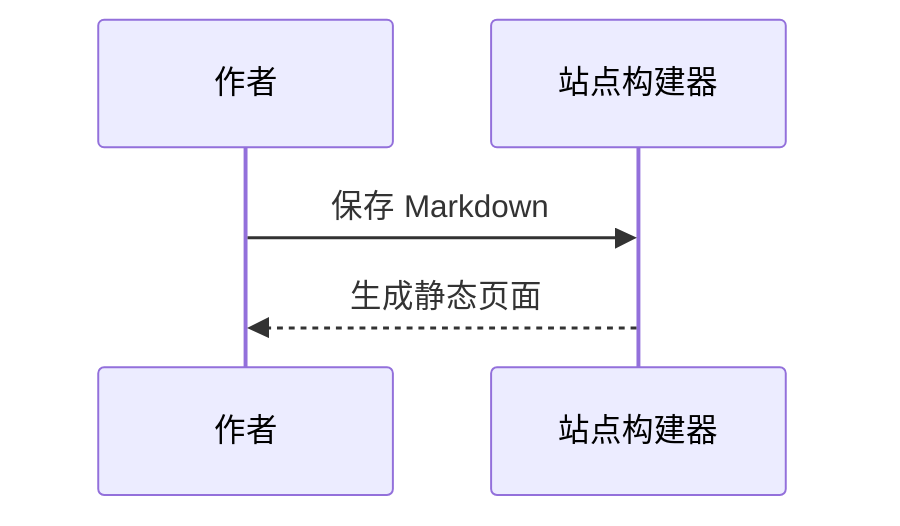

# 技术文档与图表

## LaTeX 公式

行内公式：$E = mc^2$。块级公式：

$$
\frac{-b \pm \sqrt{b^2 - 4ac}}{2a}
$$

代码中的 `$E = mc^2$` 不会被解析成公式。

## 代码高亮与复制

第 2 行演示高亮，可在代码块上测试复制。

```js{2}
const text = '# Hello, Markdown'
const heading = text.replace(/^#+\s*/, '')
console.log(heading)
```

## 代码组

::: code-group
```sh [pnpm]
pnpm install
```

```sh [npm]
npm install
```
:::

## 内容标签页

:::tabs
== 快速开始
先打开 [Markdown 语法](./markdown.md)，再看解析结果。
== 进阶
直接打开 [Muya 对照样例](./muya-fixture.md)。
:::

## Mermaid 流程图


## Mermaid 时序图


